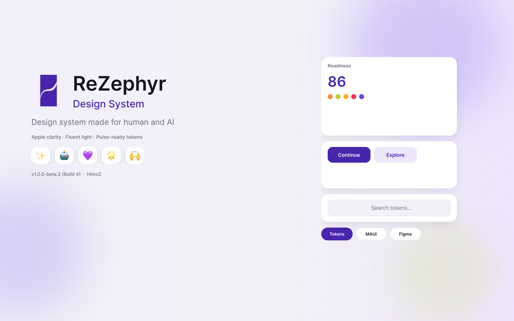

# ReZephyr

Tokenized design system — Apple HIG clarity with Fluent light, depth, and motion.

**Version:** v1.0.0-beta.3 (Build 4)  
**GitHub:** https://github.com/himoN7/rezephyr  
**Figma:** https://www.figma.com/design/QPBlsyhp2HMSmNFvyovOmm  

**Slogan:** Design system made for human and AI  
**Creator:** Hamed (himoN7) · **Studio:** HimoZ  
**License:** [ReZephyr Attribution License](./LICENSE) — use with credit · [`NOTICE`](./NOTICE) · [`PROVENANCE.md`](./PROVENANCE.md) · [`llms.txt`](./llms.txt) · [`CONSUMING.md`](./CONSUMING.md)

```text
Design system: ReZephyr by Hamed / HimoZ
https://github.com/himoN7/rezephyr
```

Products may *use* ReZephyr. Do **not** rebrand it or claim authorship.



Logo: [`brand/ReZephyr-128.svg`](./brand/ReZephyr-128.svg) · Cover assets: [`brand/`](./brand/)

## Platforms

| Stack | Artifact |
|-------|----------|
| **MAUI** | [`platforms/maui/`](./platforms/maui/) → `ReZephyrTheme.Apply(this)` · NuGet `ReZephyr.Maui` |
| **Web / CSS** | [`tokens/tokens.css`](./tokens/tokens.css) |
| **React / TypeScript** | [`platforms/react/`](./platforms/react/) · npm `@rezephyr/react` |
| **Kotlin / Compose** | [`tokens/generated/RZTokens.kt`](./tokens/generated/RZTokens.kt) |
| **Compose Multiplatform** | [`RZTheme.cmp.kt`](./tokens/generated/RZTheme.cmp.kt) + [`mapping/compose-multiplatform.md`](./mapping/compose-multiplatform.md) |
| **SwiftUI** | [`tokens/generated/RZTokens.swift`](./tokens/generated/RZTokens.swift) |
| **Flutter** | [`tokens/generated/rz_tokens.dart`](./tokens/generated/rz_tokens.dart) |
| **Avalonia** | [`platforms/avalonia/`](./platforms/avalonia/) · NuGet `ReZephyr.Avalonia` |
| **Linux GTK** | [`tokens/linux/rezephyr.css`](./tokens/linux/rezephyr.css) |
| **Tauri** | [`mapping/tauri.md`](./mapping/tauri.md) (reuses web/React) |

Install / credit details: [`CONSUMING.md`](./CONSUMING.md) · GitHub Releases ship `.nupkg`, `.tgz`, and tokens zip.

```csharp
ReZephyrTheme.Apply(this); // MAUI
```

## Simulated platform tests

```bash
npm test                 # all platforms
npm run test:maui
npm run test:flutter
npm run test:react
```

## Visual previews

```bash
python -m http.server 5173
# open http://127.0.0.1:5173/previews/
```

SwiftUI cannot run on Windows/WSL — use the **Apple** tab in previews, or a Mac for native SwiftUI. Linux apps: see `mapping/linux.md`.

## Start here

| File | Role |
|------|------|
| [design.md](./design.md) | Design bible — principles, tokens, components |
| [AUDIT.md](./AUDIT.md) | Completeness audit |
| [tokens/tokens.json](./tokens/tokens.json) | Numeric source of truth |
| [tokens/tokens.css](./tokens/tokens.css) | Web / preview CSS variables |
| [inventory/components.json](./inventory/components.json) | Figma component inventory |
| [prompts/](./prompts/) | AI agent prompts & checklists |
| [mapping/](./mapping/) | MAUI · Web · React · Flutter · Avalonia · CMP · Tauri · iOS · Android · Linux |
| [previews/](./previews/) | Web + Apple-framed HTML simulations |
| [mapping/swift-on-windows.md](./mapping/swift-on-windows.md) | Swift limits on Windows/WSL |
| [mapping/icons-emoji.md](./mapping/icons-emoji.md) | Icons vs expressive emoji |
| [figma/FIGMA_GITHUB_SYNC.md](./figma/FIGMA_GITHUB_SYNC.md) | Tokens Studio ↔ GitHub automation |

## Icons vs emoji

- **Detailed UI** (media controls, toolbars, forms, nav) → **Fluent / system icons only**.
- **Expressive places** (greetings, large bold messages, celebration) → animated emoji (Fluent → Apple → Google).

## Figma ↔ GitHub

See [figma/FIGMA_GITHUB_SYNC.md](./figma/FIGMA_GITHUB_SYNC.md). Sync file: `figma/tokens.studio.json`.

## Quick consume

**Web**

```html
<link rel="stylesheet" href="tokens/tokens.css" />
```

```css
.button-primary {
  background: var(--rz-bg-accent);
  color: var(--rz-fg-on-accent);
  border-radius: var(--rz-radius-16);
  height: var(--rz-button-primary-h);
  font: var(--rz-type-button);
}
```

**MAUI** — see [`platforms/maui/README.md`](./platforms/maui/README.md) and [`mapping/maui.md`](./mapping/maui.md).

## Agents

Paste or `@` the prompt in `prompts/implement-ui.md` before implementing UI. Run `prompts/qa-checklist.md` before claiming done.
